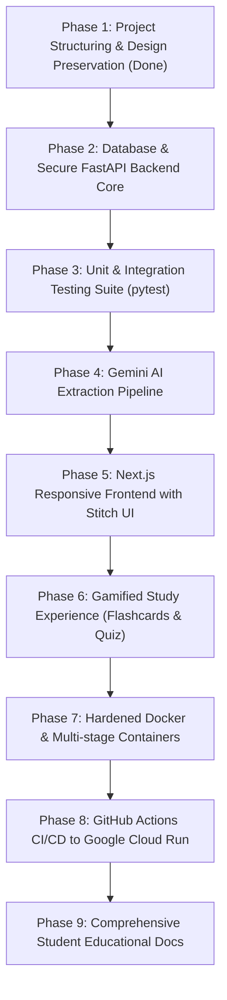

# ⚡ FlashLearn AI — Architecture & Implementation Master Plan

> **Goal**: Build an educational, gamified, and production-grade fullstack web application where students paste lecture notes to instantly generate:
> 1. **3 Key Concepts**
> 2. **Interactive Flashcards** (with 3D-flip & spaced review)
> 3. **Interactive Gamified Quiz** with instant feedback and score tracking
>
> All code, documentation, comments, and user interfaces are strictly in **English**, designed as a textbook reference for students learning modern software engineering.

---

## 1. Selected Technology Stack

| Layer | Technology | Key Reasons & Best Practices |
| :--- | :--- | :--- |
| **Frontend** | **Next.js 14+ (App Router) + TypeScript + Tailwind CSS** | Fully responsive (Mobile/Tablet/Desktop), Lucide / Google Material symbols, Dark/Light mode theme provider, modular components. |
| **Backend** | **FastAPI (Python 3.11+)** | High performance, auto-generated OpenAPI/Swagger documentation, strict typing with Pydantic v2, async handlers. |
| **Database & ORM** | **PostgreSQL + SQLAlchemy 2.0 (async) + Alembic** | Industry-standard relational data model for users, decks, flashcards, quizzes, and study progress. |
| **Authentication** | **JWT (Access + Refresh tokens) & Argon2/Bcrypt** | Secure cookie/header authentication, role-ready, rate-limited login endpoints. |
| **AI Engine** | **Google Gemini API (`gemini-1.5-flash` / `gemini-2.0-flash`)** | Low latency, structured JSON output mode, prompt engineering templates. |
| **Containerization** | **Docker & Docker Compose** | Multi-stage slim builds for local development and production images. |
| **CI / CD** | **GitHub Actions** | Automated linting, unit/integration testing, container build & security scan, automated deployment. |
| **Cloud Deployment** | **Google Cloud Run + Cloud SQL (PostgreSQL) / Supabase** | Serverless scale-to-zero containers, managed HTTPS, production grade. |

---

## 2. Target Workspace Structure

```
flash-learn-ai/
├── .github/
│   └── workflows/
│       ├── test.yml             # Lint & test frontend and backend
│       └── deploy.yml           # Build Docker images & deploy to Google Cloud Run
├── backend/
│   ├── app/
│   │   ├── api/                 # REST API endpoints (v1)
│   │   │   ├── deps.py          # FastApi dependencies (current_user, db_session)
│   │   │   └── v1/
│   │   │       ├── auth.py      # Login, Register, Refresh token, Profile
│   │   │       ├── courses.py   # Course / study session CRUD
│   │   │       ├── flashcards.py# Flashcard review & status updates
│   │   │       └── quizzes.py   # Quiz generation & submission
│   │   ├── core/                # Config, security, database session setup
│   │   │   ├── config.py        # Pydantic Settings & environment variables
│   │   │   ├── security.py      # Password hashing & JWT tokens
│   │   │   └── database.py      # Async SQLAlchemy engine
│   │   ├── models/              # SQLAlchemy database tables
│   │   ├── schemas/             # Pydantic validation models (Request / Response)
│   │   ├── services/            # Business logic (Gemini AI client, Gamification)
│   │   └── main.py              # Application entrypoint & CORS middleware
│   ├── alembic/                 # Database migrations
│   ├── tests/                   # Pytest unit & integration tests
│   ├── Dockerfile
│   ├── requirements.txt
│   └── .env.example
├── frontend/
│   ├── src/
│   │   ├── app/                 # Next.js App Router pages
│   │   │   ├── (auth)/login/    # Login & Register
│   │   │   ├── dashboard/       # Saved courses & recent activity
│   │   │   ├── generate/        # AI prompt & extraction view
│   │   │   ├── flashcards/[id]/ # Interactive flip card study mode
│   │   │   ├── quiz/[id]/       # Gamified quiz runner
│   │   │   └── profile/         # User stats, level, achievements
│   │   ├── components/          # Reusable UI components
│   │   │   ├── ui/              # Buttons, Cards, Inputs, Modals, ThemeToggle
│   │   │   ├── flashcards/      # FlipCard, DeckControls, ProgressRing
│   │   │   └── quiz/            # QuestionCard, Timer, ConfettiScore
│   │   ├── hooks/               # Custom React hooks (useAuth, useQuiz, useTheme)
│   │   ├── lib/                 # API client (Axios/Fetch wrapper), utils
│   │   └── types/               # TypeScript interfaces
│   ├── public/                  # Static assets & icons
│   ├── Dockerfile
│   ├── tailwind.config.ts
│   └── package.json
├── design_exports/              # ARCHIVED original Stitch HTML files & DESIGN.md
│   ├── landing_page.html
│   ├── login_page.html
│   ├── review_generation_via_ai_page.html
│   ├── flashcard_view.html
│   ├── mini_quizz_view.html
│   ├── user_profile_page.html
│   └── DESIGN.md
├── docker-compose.yml           # Local fullstack development orchestration
├── .gitignore                   # Comprehensive ignores for Node, Python, env files
└── README.md                    # Educational guide & setup instructions
```

---

## 3. Step-by-Step Implementation Roadmap

## 3. Security by Design & Hardening Architecture

Security is the primary priority in this project. All components adhere to the **Shift-Left** principle:

```
[Threat Model & Input Validation] 
   ↳ [Strict Schema Parsing (Pydantic v2)] 
      ↳ [Argon2id Password Hashing & Short-Lived JWT] 
         ↳ [Rate Limiting & Security Headers] 
            ↳ [SQL Injection Immune (SQLAlchemy 2.0 ORM)] 
               ↳ [Zero Technical Leaks (Custom Exception Handlers)]
```

### Security Checklist:
1. **Password Hashing**: Argon2id / Bcrypt with automatic salt generation; zero plain-text handling.
2. **Authentication**:
   - Access tokens (15-30 min validity) & Refresh tokens stored securely.
   - Protected endpoint dependencies rejecting forged or expired tokens.
3. **API Hardening & Swagger**:
   - Rate limiting on `/api/v1/auth/*` and `/api/v1/ai/generate` to prevent brute-force attacks and abuse.
   - CORS strictly restricted to authorized frontend origins.
   - Security headers: `X-Content-Type-Options: nosniff`, `X-Frame-Options: DENY`, `Strict-Transport-Security`, `Content-Security-Policy`.
4. **Input Sanitization**:
   - Strict Pydantic models with maximum length constraints on note inputs to avoid DoS/memory exhaustion.
   - Forbidden extra fields (`extra='forbid'`) on sensitive payloads.
5. **Zero Technical Data Leaks**:
   - Centralized exception handlers converting unhandled internal exceptions into safe, generic JSON error envelopes (`{"detail": "..."}`).
   - Database errors, stack traces, and environment paths are never exposed in production responses.
6. **Infrastructure & Container Hardening**:
   - Multi-stage minimal Docker builds.
   - Container executes under an unprivileged non-root user (`appuser`).
   - Secrets managed strictly via environment variables (Google Secret Manager / GitHub Secrets) — no hardcoded secrets anywhere.

---

## 4. Step-by-Step Implementation Roadmap



### Phase 1: Repository Organization & Guidelines (Completed)
- Archived original Stitch HTML files & design tokens in `design_exports/`.
- Configured `.gitignore` and agent guidelines (`AGENTS.md`) enforcing security, educational comments, and English-only convention.

### Phase 2: FastAPI Backend Core & Secure Auth API
- Set up directory structure: `backend/app/{api,core,models,schemas,services}`.
- Configure asynchronous PostgreSQL engine with SQLAlchemy 2.0.
- Implement secure authentication with Argon2id/Bcrypt and JWT:
  - `POST /api/v1/auth/register` (unique email checks, password strength validation)
  - `POST /api/v1/auth/login` (rate-limited, returns token pair)
  - `GET /api/v1/auth/me` (requires valid bearer token)
- Configure CORS, security headers middleware, and centralized exception handler.

### Phase 3: Automated Testing Suite
- Setup `pytest` with `pytest-asyncio` and `httpx`.
- Write unit tests for:
  - Password hashing & verification.
  - JWT creation & expiration.
  - User registration & duplicate conflict handling.
  - Authentication middleware & invalid token rejection.
  - Rate limiting behavior.

### Phase 4: Gemini AI Extraction Pipeline
- Integrate Google Generative AI SDK (`gemini-1.5-flash` / `gemini-2.0-flash`).
- Enforce strict JSON schema parsing for:
  - 3 Key Concepts (title, summary, real-world example).
  - 5–10 Flashcards (front prompt, back answer, hint).
  - 5 Interactive MCQs (question, 4 choices, correct answer, explanation).
- Mock testing for AI generation to run in CI without live API quota usage.

### Phase 5: Next.js 14 Frontend with Stitch Design & Theming
- Initialize Next.js 14 with TypeScript, Tailwind CSS, and Lucide icons.
- Import design tokens from `design_exports/DESIGN.md` (colors, typography, container elevations).
- Build light/dark mode switcher with persistent state.
- Create responsive layouts for Mobile, Tablet, and Desktop.

### Phase 6: Gamified Features
- 3D Flashcard review runner with flip animation and spaced repetitions.
- Gamified quiz runner with live score tally, timer, instant feedback (green/red), and victory confetti.
- Student profile view with XP, level progression, and study streak.

### Phase 7: Docker Multi-Stage Builds & Compose
- Minimal production Dockerfile for backend (`python:3.11-slim`, non-root user).
- Minimal production Dockerfile for frontend (`node:20-alpine`, Next.js standalone mode).
- `docker-compose.yml` for unified local development (`backend`, `frontend`, `postgres`).

### Phase 8: GitHub Actions CI/CD to Google Cloud Run
- Workflow 1: Continuous Integration (`.github/workflows/ci.yml`) testing code quality on every PR.
- Workflow 2: Continuous Deployment (`.github/workflows/deploy.yml`) building container images, scanning vulnerabilities, and deploying serverless containers to Google Cloud Run.

### Phase 9: Educational Documentation
- Clean English `README.md` and inline comments designed for students to understand every layer of the architecture.

